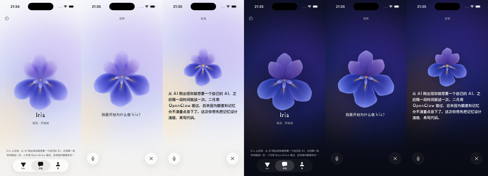
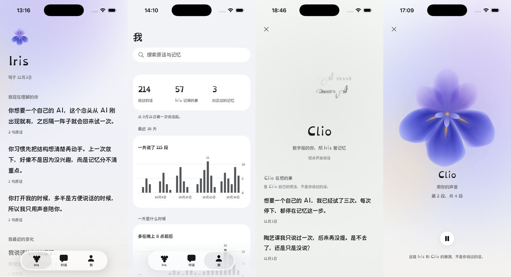
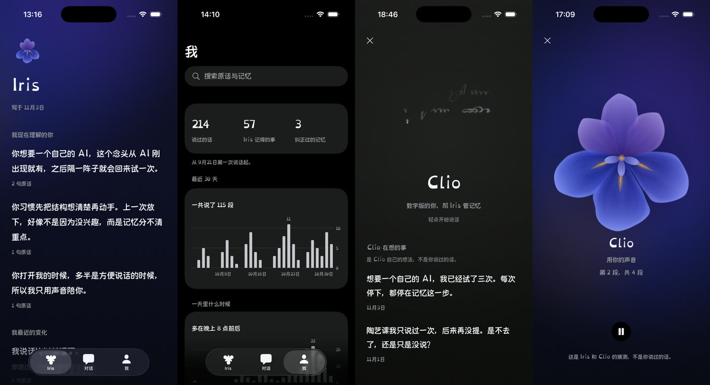
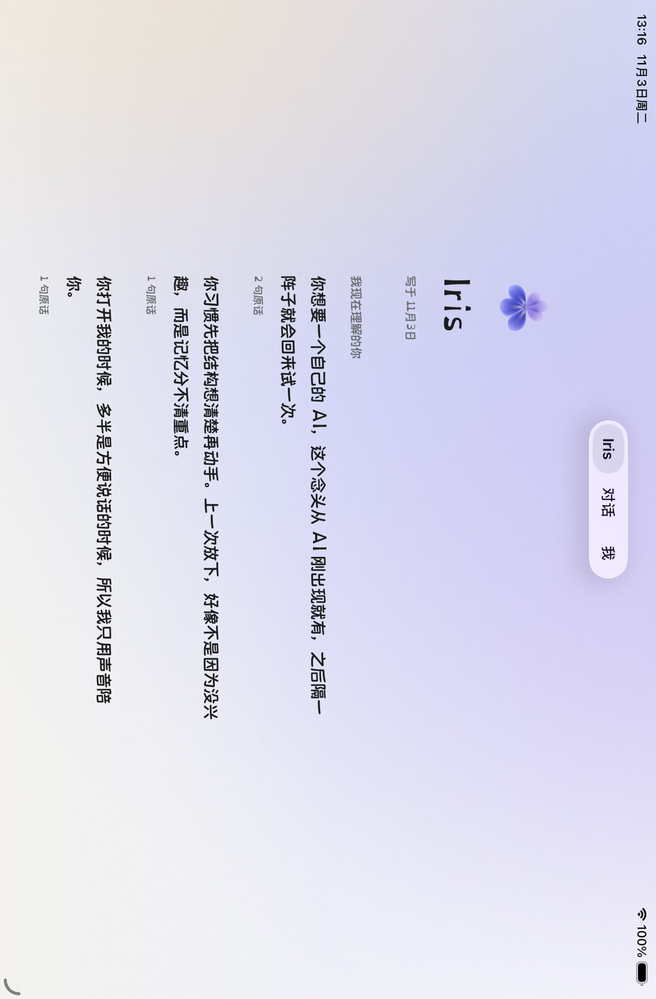
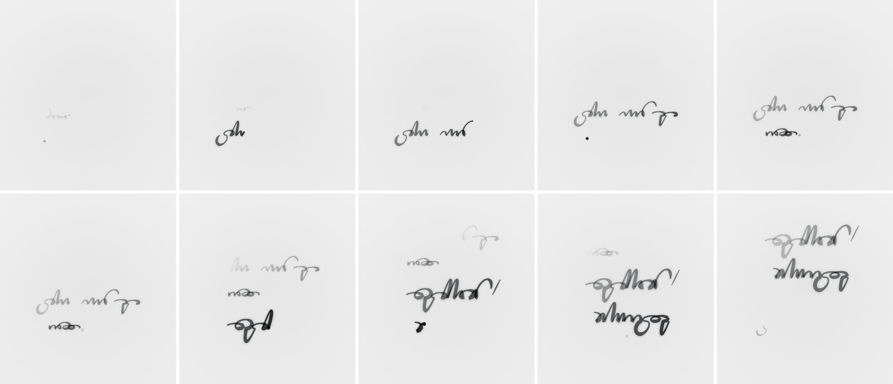
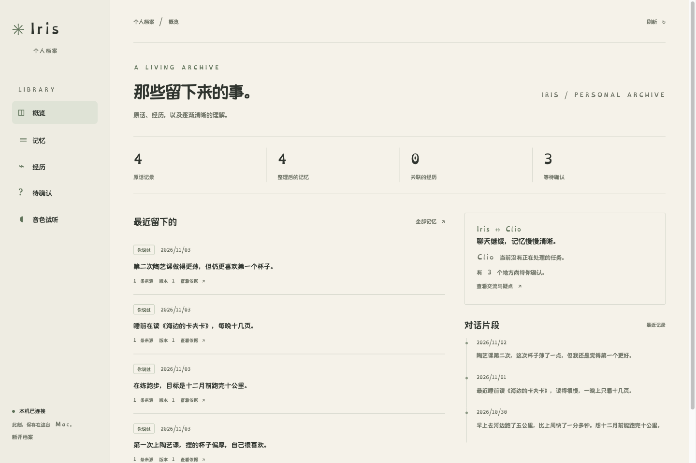
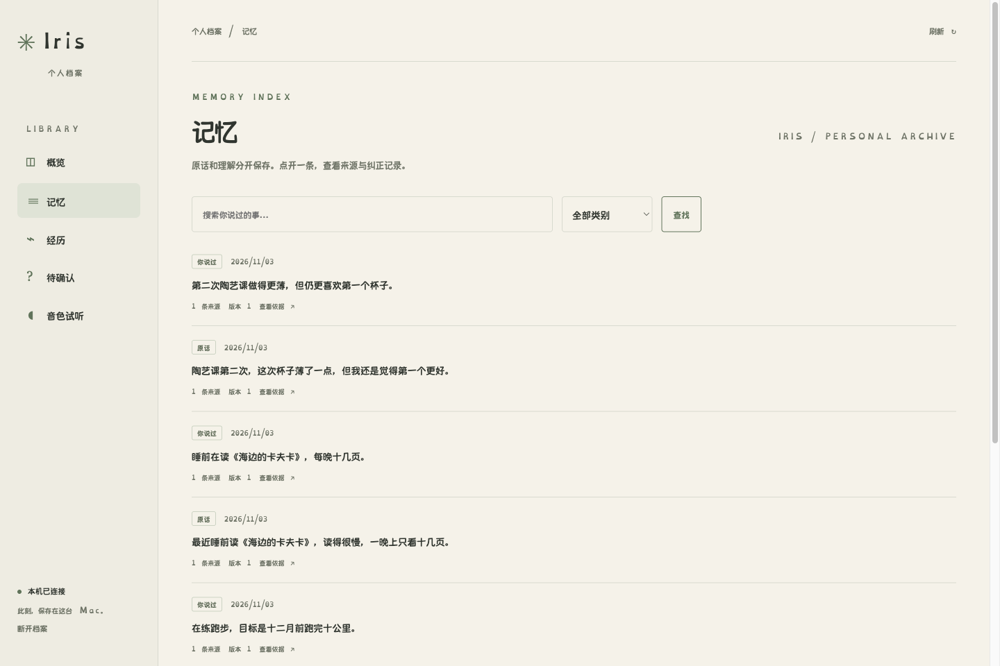
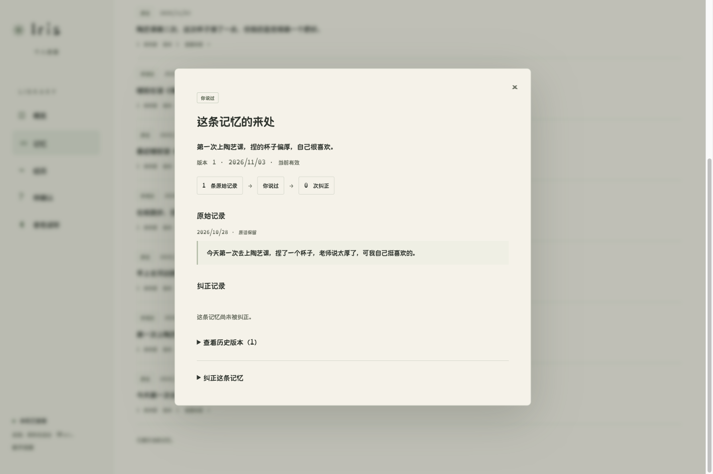
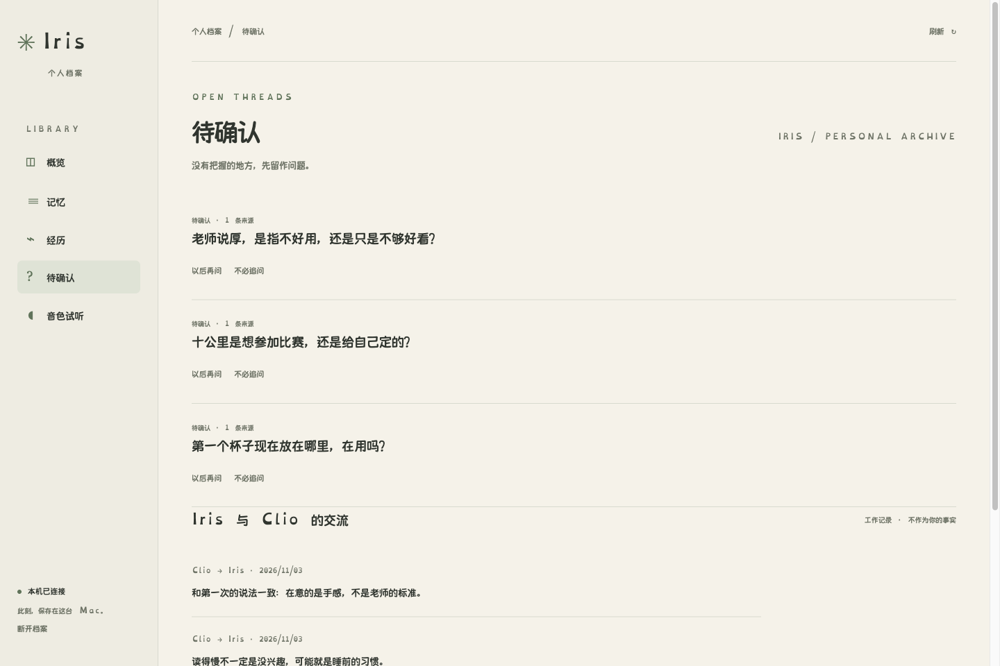
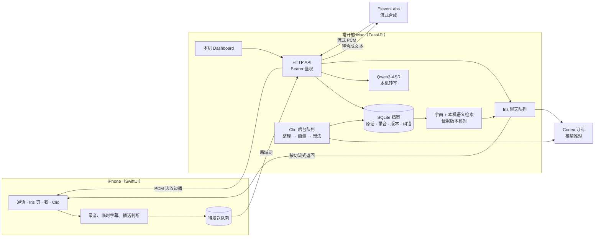

  

<h1 align="center">Iris</h1>

一个只用声音交流、会长期记住我的个人 AI。 长期目标：数字世界的我。

  
  &nbsp;&nbsp;&nbsp;
  

左：和 Iris 通话。右：Clio 的笔，我说话时它边听边记。

> 这个仓库放的是项目介绍、架构和截图，**不含源代码**。项目还在原型阶段，在我自己的 iPhone 和 Mac 上运行。

[当前进展](#现在做到哪2026-11-07) · [架构说明](docs/architecture.md) · [优化路线与验收](docs/improvement-plan.md)

## 为什么做

从 AI 刚出现，我就想要一个属于自己的 AI，之后每隔一段时间就试一次。2026 年 2 月我用 OpenClaw 搭过一版，后来因为额度、Telegram 兼容、各种 bug，还有记忆的重点一直不清楚，就放下了。

这一次我换了顺序：**先把记忆设计清楚，再写代码。**

我想要的效果是：几个月后我问它“我最开始为什么做这个项目”，它能分清哪个是最早的念头、哪次是尝试、为什么放弃、什么时候重新开始，并且拿得出我当时的原话。

## 目标

长期目标是“数字世界的我”。它持续积累我的经历、做选择的原因、目标以及这些东西的变化，主动加深对我的理解，通过一套我自己设计的语音体验和我交流。

**档案长期保留，理解可以纠正，模型和界面可以更换。**

落到具体的事情上：

- **说过的就留下。** 我说过的话先可靠保存，再去整理。每条都有出处，能找回、能纠正、能恢复。模型认为“不重要”，不能成为丢掉原话的理由。
- **分清来源。** 当时说的、事后回忆的、AI 推测的，分开存，回答时也分开说。AI 的猜测不能变成证据，同一件事讲两遍也不会变成两条证据。
- **能改正。** 纠正一处，依赖它的摘要、画像、待问的问题和还没播出的语音都会跟着更新。旧的错误不会因为换了个问法又冒出来。
- **按问题回忆。** 问“当时为什么”就去找起源；问“现在怎样”就看最新的决定；问“我是不是总这样”，要找跨时间的例子，也要找反例。不能只看哪条最近、哪条字面最像。
- **只用声音。** 没有文字聊天。什么时候接话、怎么被打断、用什么声音，都是自己设计的。
- **有分寸地主动。** 问题要有依据、挑时机，不拿提问的数量衡量效果。

## 两个角色

|  | **Iris** | **Clio** |
| --- | --- | --- |
| 是谁 | 和我说话的那个 AI | 管记忆的、数字版的我 |
| 在哪 | 主界面，打开 App 就是 Iris | “我”页里的一个入口 |
| 样子 | 一朵鸢尾花，也是 App 里唯一有颜色的东西 | 一支墨色的笔，边听边写 |
| 声音 | Anna（ElevenLabs） | 我自己的克隆声音 |
| 做什么 | 聊天、回忆，在合适的时候问我问题 | 整理每一条新记忆；觉得不对就找 Iris 商量；空闲时自己想事情 |

Clio 发现记忆不对劲时会去找 Iris 商量，比如和已有的记忆冲突、时间或人物说不清、Iris 的备注比我的原话说得更肯定。商量最多四句，结论只有四种：照记、改了再记、先放着等问我、不记。选“先放着”就必须附上要问我的问题，之后由 Iris 找合适的时候来问。

这段商量可以在 App 里**旁听**，Iris 和 Clio 各用自己的声音念出来。跟 Clio 说话，就是现实中的我在和数字版的我讨论问题。

## 截图

### 通话

左起依次是等待、在听、在说，浅色和深色各一组。整个界面只有花有颜色。花会跟着我的声音和 Iris 的声音动。当前版本在说话时显示临时字幕，停顿后用本机 Qwen 的结果校对；识别失败或出现明显词表污染时保留 Apple 原转写。临时字幕和校对结果都可能有误，不能只因模型返回成功就认为它更准确。

### 页面

从左到右：

- **Iris 页**：Iris 写下的“我现在理解的你”，每一段都标着依据了几句原话。
- **我**：搜索原话和记忆，查看统计。
- **Clio**：笔、Clio 在想的事，以及和 Iris 商量过的事。
- **旁听**：Iris 和 Clio 的商量，用各自的声音念出来。

iPad mini

### Clio 的笔

- 平时，Clio 用小而淡的字写自己的事。
- 我开口时，它另起一行，压低笔尖等着，差不多一个音节写一个字母。声音越大，笔画越粗。
- 想事情的时候，笔悬在纸上打小圈。
- 轮到 Clio 说话时，字写得更大、更放开。

墨刚落下时最深，十秒后干掉消失。带声音的完整一来一回见 [clio-pen-exchange.mp4](images/clio-pen-exchange.mp4)，两边的声音都是本机的示例声音。

### 本机 Dashboard

档案的权威副本在 Mac 上，Dashboard 也在本机打开。当前支持本机同源自动建立会话，也保留一次性链接入口，主密钥不会写进网页。在这里可以查看每条记忆的来源、版本和纠正，也能看到经历、等待我确认的问题，以及 Iris 和 Clio 之间的交流。后来加入的记忆关系视图和人格文档仍读取同一份档案。

<table>
  <tr>
    <td></td>
    <td></td>
  </tr>
  <tr>
    <td align="center">整理后的记忆</td>
    <td align="center">一条记忆的原话、来源和版本</td>
  </tr>
  <tr>
    <td></td>
    <td></td>
  </tr>
  <tr>
    <td align="center">待确认的问题，以及 Iris 和 Clio 的交流</td>
    <td></td>
  </tr>
</table>

这些是早期界面的演示截图，不代表最新版本的全部页面；使用单独的演示档案，不是我的真实档案。

## 架构

- **iPhone 是薄客户端。** 它负责说话、播放、查看和纠正。没传到 Mac 的话先存在手机里，拿到 Mac 的保存回执后才算“后台已保存”。手机不维护第二套记忆。
- **Mac 持有唯一的权威档案。** 原话和录音保存后不再改动。整理出来的记忆有版本、有来源，纠正会作为修订事件记下来。
- **两条队列分开。** Iris 的聊天优先；Clio 的整理、商量和每天的想法在聊天空闲时领取任务。前台不等待记忆整理完成；后台工作仍共用本机资源和订阅额度，实际等待需要持续测量。
- **模型可以替换。** 推理目前用本机登录的 Codex 订阅，转写用 Mac 上的 Qwen3-ASR 配合个人词表，语音用 ElevenLabs。规则和档案都属于这个项目，不依赖某一家的记忆功能。

更细的说明见 [docs/architecture.md](docs/architecture.md)，内容包括一轮语音对话怎么走、记忆模型、保存状态、纠错如何传递、Clio 的商量，以及 API 一览。

## 技术栈

| 部分 | 用了什么 |
| --- | --- |
| iPhone / iPad | SwiftUI，iOS 17+，没有第三方运行时依赖；花和笔都用 Canvas 实时绘制 |
| 后端 | Python 3.12、FastAPI、SQLite（schema 6），依赖用 uv 锁定 |
| 推理 | 本机 Codex（ChatGPT 订阅），不会悄悄切换成付费 API |
| 转写 | Mac 上的 Qwen3-ASR 0.6B 加个人词表；Apple 语音识别负责临时字幕和插话 |
| 检索 | 字面检索 + 本机 bge-m3 语义检索；语义服务不可用时回退字面检索 |
| 语音 | ElevenLabs 流式 PCM：Iris 用 Anna，Clio 用我的克隆声音 |
| Dashboard | 本机静态页面，同源自动连接或一次性链接换取 8 小时的 HttpOnly 会话 |

## 现在做到哪（2026-11-07）

后端 v0.5 / schema 6 在自己的 Mac 上运行，iPhone 通过局域网连接。以下区分实际启用、代码就绪和仍在实验的部分：

| 部分 | 当前状态 | 仍需验证 |
| --- | --- | --- |
| 语音通话 | 已启用流式回复、分句 PCM 播放、实时字幕和意图插话 | 冷启动、耳机、长通话及不同噪声下的端到端体验 |
| 长期记忆 | 已有来源、版本、纠错、聊天结束后归并和固定质量验收集 | 换模型或提示词后，继续检验漏记、误记与纠错回退 |
| 按问题回忆 | 已启用字面 + 本机语义混合检索，区分起源、现状和跨时间规律 | 找到相关材料不等于回答一定正确，需要回答层验收 |
| 游戏与故事 | 已加入独立的跨轮活动状态；不作为个人事实存档 | 多轮会话重建、换题与中途打断后，答案和情节能否持续一致 |
| Iris 与 Clio | 已有独立通话、双方旁听、每日有上限的交流、想法反馈与版本化 SOUL | 自然分享的时机，以及人格变化在长期使用中是否有帮助 |
| Dashboard | 与 App 共用档案，可查看记忆、关系、来源、纠错和双方人格 | 更大资料量下的可读性与检索体验 |
| 长语音分块 | **实验关闭**；当前继续完整录音识别 | 原音逐字/意思核对通过，并证明手机实际等待缩短后才开启 |
| 外出连接 / 异地备份 | 已有连接切换、加密备份和恢复演练代码 | 尚未完成正式启用与真实外出/备份恢复验收 |

**延迟不混用口径。** 早期四轮的 2.5–5.1 秒是从录音结束到首音频排入播放的测量，不包含此前的断句等待，也不是人耳听见的声学测量。现在按断句、上传、识别、首文字、合成、排队和播放器渲染分别计时；尚未发布可代表所有场景的统一延迟数字。分块实验的尾段推理更快，也不能直接等同于手机回复更快。

截至 11 月 7 日，本地最近一轮后端回归记录为 734 项通过、1 项跳过，另有 75 个子测试通过；iOS 单元测试为 119 项通过。这些是私有实现的本地测试记录，**不是本仓库的 CI 或独立性能评测**，也不代表上表所有实机场景都通过。

## 接下来

1. **先保证听对，再缩短等待。** 用固定旧录音检查否定、数字、专名和真实重复；分块通过质量与手机延迟两道验收后再启用。
2. **把持续聊天测完整。** 活动状态已经有了，接着验证十轮以上、会话重建、换题和打断；询问类型不能被擅自当成改变偏好。
3. **检索和回答一起验收。** 不只看找到多少条，还要看最终回答是否引用正确、晚到补述是否关联、纠正后旧说法是否复活。
4. **主动与人格有反馈。** 已回答的不再追问，拒绝或推迟的想法不换词重推；SOUL 候选通过行为测试再激活，并可回滚。
5. **验证恢复和外出使用。** 先在隔离目录演练完整恢复、验证网络切换，再决定正式启用；迁云时保持单主写入。

每项的现有基础、改进做法和通过条件见 [优化路线与验收](docs/improvement-plan.md)。源代码公开、云服务器迁移和更多采集来源都不作为已完成能力。

## 关于这个仓库

这里只有介绍、架构文档和截图，源代码没有放进来。App 截图来自设计预览和模拟器，Dashboard 截图用的是演示档案。

