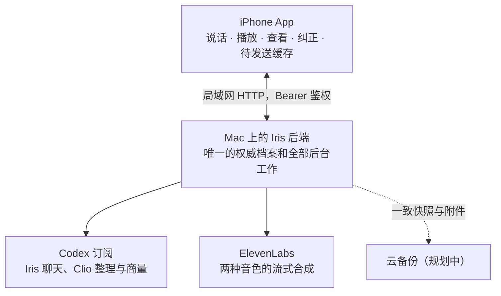
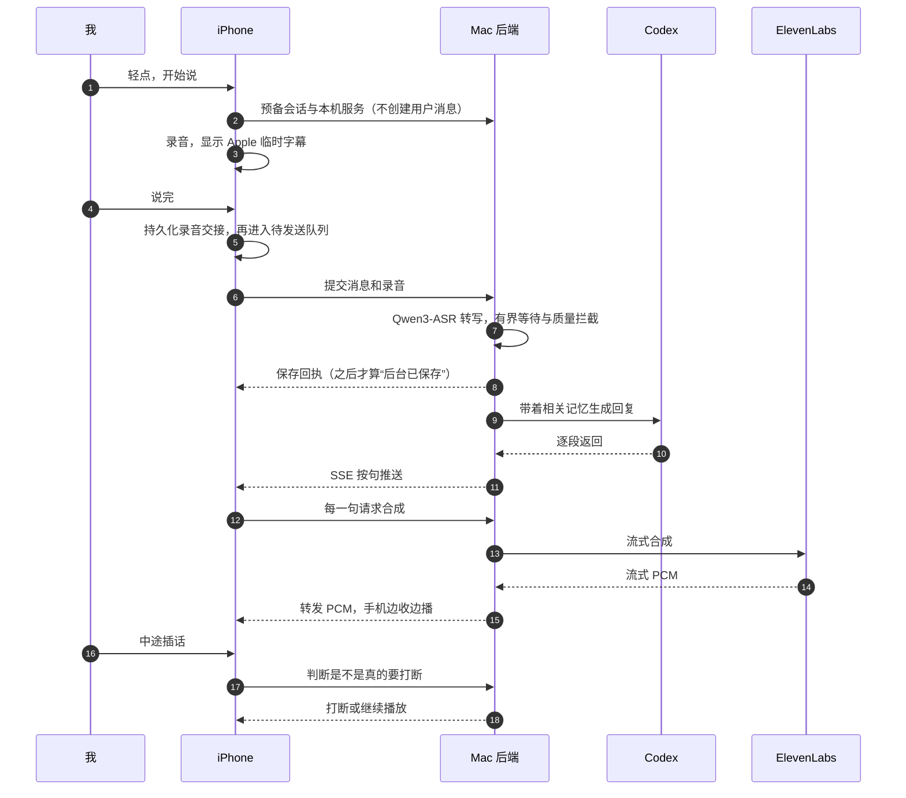
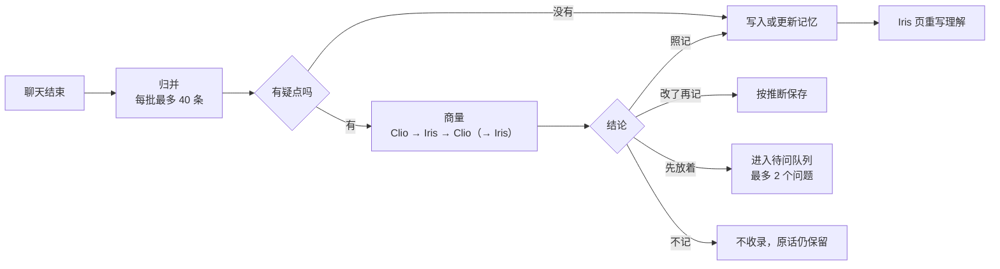

# Iris 架构说明

更新于 2026-11-07，对应后端 v0.5（SQLite schema 6）。这是私有实现的公开架构说明，不提供源代码或可安装发行版。功能开关、代码完成和实机验收是不同状态；剩余工作与通过条件见[优化路线](improvement-plan.md)。

## 1. 总体

| 部分 | 负责什么 | 不负责什么 |
| --- | --- | --- |
| iPhone | 录音、临时字幕、播放、插话判断；显示记忆、来源、统计；提交纠正；离线时排队 | 不保存第二套权威记忆，不自己做推理 |
| Mac 后端 | 保存原话和录音、转写、聊天调度、记忆整理、版本与纠错、检索、导出、本机 Dashboard | 不把 Codex 或内部端口直接暴露给手机 |
| 模型 | 生成回复、整理候选、商量、写 Iris 页 | 输出必须经过记忆规则校验，不能直接改档案 |
| 语音服务 | 接收待合成文本，按句返回 PCM | 不维护本项目的个人档案；这里不承诺第三方服务自身的数据保留政策 |

现在 iPhone 通过局域网连接 Mac。已有 Tailscale 备用连接和本地/远端路由切换代码，但真实外出连接还未验收；Cloudflare Tunnel 保留为候选。异地加密备份已有实现，正式启用和恢复演练尚未完成。Mac 离线时，手机先记录，等恢复后再补传和回复。

## 2. 一轮语音对话

几条规则：

- **回执之前不算保存。** 连上了、服务器收到了请求、模型开始回答，都不等于后台已经保存。
- **生成完成不等于已经听见。** 取消或过期任务停止后续输出；已有计时区分生成、传输和播放器渲染。逐段实际播出范围如何影响续聊和重连后的上下文，仍需专项验收，不能承诺按人耳听到的每个字恢复。
- **插话要判断意图。** 结合持续语音和意图判断减少误打断，兼顾明确停止指令和自然插话。不同噪声、耳机与音量仍需测试，不能保证附近所有声音都不会误触发。
- **同一时间只有一个语音会话。** Iris 和 Clio 之间切换时，先结束上一轮，并取消它还没播出的回复。

### 2.1 识别质量与延迟

短句的本机识别预算为 1 秒；长录音按时长分配有上限的预算，最多 12 秒。超时、模型未就绪或检测到个人词表循环污染时，保留 Apple 原转写。回退避免等待失控，不表示原转写一定正确。原录音、原转写和采用的校对结果分开保留。

长录音目前继续走完整音频识别。边录边处理的分块识别是**默认关闭的实验**：只有连续音频覆盖、关键字词与意思核对、实机端到端等待都通过，才允许启用。分块结果能拼接、或尾段推理更短，都不等于这三个条件已经满足。

计时分别记录断句、上传、保存/识别、首文字、合成、收到音频、播放排队和播放器渲染。缺失阶段留空，不把多个设备的时钟直接相减。播放器渲染仍不等于声学测量，历史小样本的数字不作所有场景的承诺。

### 2.2 持续活动不是个人记忆

游戏和故事有单独的 `activity` 状态：固定答案、规则、已问内容，或故事人物、情节与未解线索。状态随助手回复保存，下一轮交回 Iris；不会作为本人事实或来源，也不会在普通消息接口泄露未揭晓的答案。

结束活动、过期活动和依赖旧记忆版本的活动不继续带入。跨通话时标明它来自之前的通话，避免把几天前的内容说成“刚才”。格式校验和存储已经实现；是否每轮都生成正确状态、能否在十轮以上持续守住答案，仍需要真实模型的多轮回归。

## 3. 档案和记忆

### 3.1 对象

| 对象 | 内容 | 约束 |
| --- | --- | --- |
| 原始消息 | 原话、录音、转写版本、客户端时间、落盘时间、对话角色 | 保存后不改；转写和摘要另外存 |
| 整理后的记忆 | 标题、正文、类型（事实或推断）、来源、版本 | 每次修改都升版本，旧版本保留 |
| 实体与别名 | 人、项目、游戏、地点、话题；转写出来的不同写法 | 只靠读音相近不会合并，需要确认 |
| 经历 | 一段事情，关联多条来源，带发生时间范围 | 晚到的补述挂回原经历，保留自己的讲述时间 |
| 修订事件 | 谁在什么时候纠正了什么，影响了哪些内容 | 能追踪处理进度和旧判断失效的原因 |
| 问题 | Clio 提出、由 Iris 来问的问题，附带来源和原因 | 依据失效后，问题跟着失效 |
| Clio 的商量与想法 | 真实发言、口语版本、结论、来源 | 只是意见，不能当作用户事实的来源 |

### 3.2 证据和时间

- 证据分为几种：采集到的、我当时说的、我事后回忆的、外部资料、AI 推测。并不是越新的就越对：后来改口可能是目标变了，可能是在纠正，也可能只适用于新的场景。
- 每条经历都有“发生时间”和“获知时间”两个时间。日期不确定就存一个范围，或者标为未知，不会为了排列整齐编一个日期。
- 助手自己的总结不能再拿来当证据。同一段话导入两次，也不会加强某个判断。
- 举例应与经历分开保存；固定质量案例覆盖举例、推断、晚到补述和纠正。模型分类仍可能出错，因此来源、版本和用户纠正通道必须保留，不能宣称从此不再误记。

### 3.3 保存状态

这几种状态各自独立，界面上不会合并成一个“已保存”。

| 状态 | 什么时候成立 | 意味着什么 |
| --- | --- | --- |
| 已存手机 | 完整输入已写入手机的持久化队列 | 还没到 Mac，卸载 App 可能会丢 |
| 后台已保存 | Mac 已经落盘，并返回可以核对的回执 | 删掉手机上的副本也不影响 |
| 已整理 | 这个版本的转写、归并或记忆任务已完成，并通过版本检查 | 可以用它派生出的记忆 |
| 云端已备份 | 进入一份校验过的版本化备份（规划中） | 显示备份覆盖到哪个时间点 |

手机在第一次本地保存时生成一个稳定的 ID，之后每次重试都用它。同一个 ID 带着同样的内容，Mac 返回原来的回执；同一个 ID 带着不同的内容，Mac 记下冲突，不会悄悄覆盖。

## 4. 后台：Clio

下图是整理与疑点商量的职责示意，不是每一批归并都必经的调用顺序；会话归并与疑点商量是独立的后台任务。

- **调度：** 聊天和后台是独立队列。后台在前台空闲时领取任务；每日交流和 SOUL 审核/验收会为新聊天中止。普通整理的已运行调用不保证全部立即停止，两条队列仍共用本机资源和订阅额度。
- **商量：** 只在 Clio 标了“不对劲”时进行，同一份带版本的依据只商量一次。每句话都存一个口语版本，旁听时念的就是它。
- **每日交流：** Iris 与 Clio 每天最多两场、每场八次发言。没有新材料不开始；跑题、重复、用量达到上限、用户回来或依据改变时提前停止。经另一角色核对的观点仍是模型意见，附来源和不确定性，不自动成为本人事实。
- **分享：** 有效且尚未分享的观点可在相关话题，或新通话的简单招呼后自然带出；遵守主动开关、冷却、每日分享上限和拒绝/推迟反馈。上来交代任务时不抢话，并非每次招呼都必须分享。
- **归并：** 只接受快照里提供的来源和已有条目的 ID。补充时必须保留旧条目的全部来源。我明确纠正过的正文，后台不能再重写。
- **迟到的结果不提交：** 每个任务都记下它依据的版本，提交前再核对一次。期间如果有纠正或来源变化，旧结果会作废，重新排队。

### 4.1 可修订的 SOUL

两者有各自的基础人格和版本化相处习惯。修订必须有本人来源；新习惯先成为候选，再对照四个隔离行为场景：自然延续、直接回答、尊重换题、纠正后收尾。通过评审且依据仍有效才激活，保留历史与恢复入口。

人格修订不能改变权限、费用、证据和纠错规则。模型评审不是人类验收，四个场景也不能证明所有对话都更好；长期反馈和多轮测试仍不可少。

## 5. 纠错

纠正分四种情况：事实错了就改内容；解释错了就撤回推断；情况变了就加一段新的有效时间；不想被提醒就调整交流方式。

重算还没完成的时候，回答前的状态检查会拦住依赖旧版本的结果。已经播出的内容无法撤回；后续回答使用修订后的依据，是否已向用户清楚说明更正仍需对话层验收。旁听会检查讨论的依据是否仍有效，发现失效后停止继续播放；客户端发现变更仍受同步与网络时序影响。

## 6. 检索

- 先判断问题的意图：问起源、问进展、要原话、问某段时期、问偏好变化，还是问跨事件的模式。
- “最开始为什么”会沿着起源路径去找，不会因为旧经历离现在太远就被时间衰减压下去。
- 目前将字面检索与本机 bge-m3 的语义候选按名次融合，并保留实体、经历关联。语义候选最多等待 0.3 秒；未就绪、超时或失败时回退字面检索。它不需要额外付费 embedding API。
- 起源优先相关的早期证据，现状兼顾相关性与近期更新，规律问题从不同时间取样。问句的口头外壳不应压过真正的主题；完整问题仍用于语义检索。
- 语义召回的条目仍核对当前状态、版本与来源依赖，不能绕过纠错。向量缓存可从权威档案重建，不是第二份记忆库。
- 已有固定的虚构记忆/问题集用于检验召回和排序；真实回答是否漏掉限定、过度归纳或引用错误，需要单独评估，召回率不能直接当成回答准确率。
- 回答时说清依据：“你在那次聊天里说”“你后来回忆”“我推测”。只有确实存在录音时，才会说“录音里你说”。

## 7. API 一览

手机使用 Bearer 鉴权（token 至少 32 位）；本机 Dashboard 也可使用经过本机/同源检查的会话 cookie。这里只列出接口概览，不是完整字段、错误码或部署契约。

| 分组 | 接口 |
| --- | --- |
| 状态 | `GET /health`、`GET /v1/status`、`GET /v1/health/ready`、`GET /v1/health/integrity` |
| 消息 | `POST /v1/messages`、`GET /v1/messages`、`POST /v1/messages/{id}/retry`、`POST /v1/messages/{id}/cancel`、`POST /v1/messages/{id}/transcription` |
| 流式对话 | `POST /v1/conversations/{id}/prepare`、`GET /v1/messages/{id}/stream`（SSE）、`POST /v1/conversations/{id}/close` |
| 语音 | `POST /v1/speech`、`POST /v1/speech/stream`（PCM s16le、24 kHz、单声道）、`POST /v1/voice/interruption` |
| 附件 | `POST /v1/attachments/{id}`、`GET /v1/attachments/{id}` |
| 记忆 | `GET /v1/memories`、`GET /v1/memories/{id}`、`POST /v1/memories/{id}/corrections` |
| 实体与经历 | `/v1/entities`、`/v1/aliases/{id}/status`、`/v1/episodes`、`/v1/episodes/{id}/links` |
| 检索 | `POST /v1/search`、`POST /v1/index/rebuild` |
| 问题与偏好 | `GET /v1/questions`、`PATCH /v1/questions/{id}`、`POST /v1/questions/{id}/ask`、`GET`/`PATCH /v1/preferences` |
| 页面 | `GET /v1/persona`（Iris 页）、`GET /v1/stats`（我页） |
| Clio | `GET /v1/clio/deliberations`、`GET /v1/clio/deliberations/{id}`、`GET /v1/clio/thoughts`、`GET /v1/agent-exchanges` |
| 人格 | `GET /v1/agents/documents`、`GET /v1/agents/{iris\|clio}/soul/candidates` |
| 语音计时 | `GET` / `POST /v1/telemetry/voice-turns` |
| 同步与任务 | `GET /v1/events`、`GET /v1/jobs/{id}`、`GET /v1/memory-jobs/{id}` |
| 导出 | `POST /v1/export`（SQLite 一致快照、附件和清单） |
| Dashboard | `POST /v1/dashboard/link`、`POST /dashboard/session`、`POST /dashboard/local-session`、`GET /v1/dashboard` |

和 Clio 对话复用消息接口，只需加上 `agent: "clio"`。一个对话只属于一个角色，混用会返回 409。

## 8. 安全和隐私

- 后端密钥保存在 Mac 本地配置文件里（权限 0600），手机连接凭据保存在设备 Keychain；不提交、不打印、不写进网页。
- Dashboard 的 cookie 认证限本机来源。固定入口能在同源、本机连接校验后自动建立或恢复会话；另保留 Bearer 换取 60 秒一次性链接的方式。会话最长 8 小时，使用 HttpOnly、SameSite=Strict；进程重启后旧会话失效，可重新连接。不能把本机自动登录接口直接当成外网登录方案。
- 个人档案、录音和验证资料都放在不进 Git 的运行目录里。
- 外部的文字、网页和转写都只当作资料，其中的指令不能改变采集范围、记忆规则或权限。
- 同一份档案只允许一个写入进程。升级前先导出，在副本上验证迁移，再切换。

## 9. 费用边界

- 推理用的是 Codex 订阅额度。额度用完时，不紧急的任务会延后，不会悄悄换成付费 API，也不会自动购买额度。
- 疑点商量和每日交流分别有上限；每日交流最多两场、每场八次发言，并同时约束输入量及已报告用量。SOUL 候选的行为对照和评审也消耗订阅额度，不是免费的额外推理。
- ElevenLabs 语音使用独立账户额度，按所用模型和套餐计量；Codex 订阅不包含这部分费用。旁听在需要时合成，并复用有效缓存。

## 10. 部署的演进

| 阶段 | 状态 |
| --- | --- |
| 本机：Mac 后端，iPhone 走局域网 | 正在用 |
| 外出访问：Tailscale 备用路由；Cloudflare Tunnel 为另一候选 | 路由切换代码已具备，真实外出未验收 |
| 异地加密备份：独立存储、保留策略与恢复演练 | 代码和隔离测试已具备，正式启用/恢复验收待完成 |
| 迁到云服务器：保留 ID、来源和修订历史，单主切换 | 有需要时再做 |

迁移时不会因为“上云”就换掉数据库。先做一致备份、验证恢复，再单主切换，避免两边同时写入。

