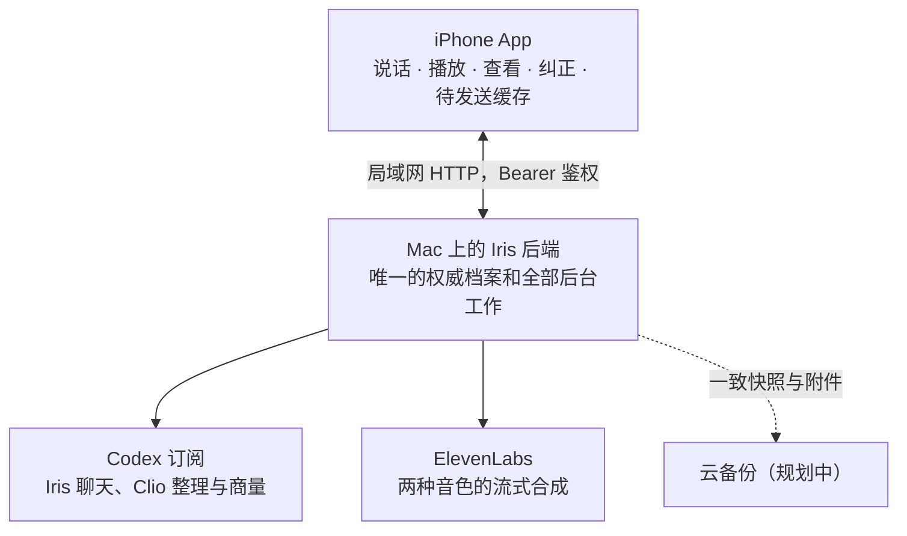
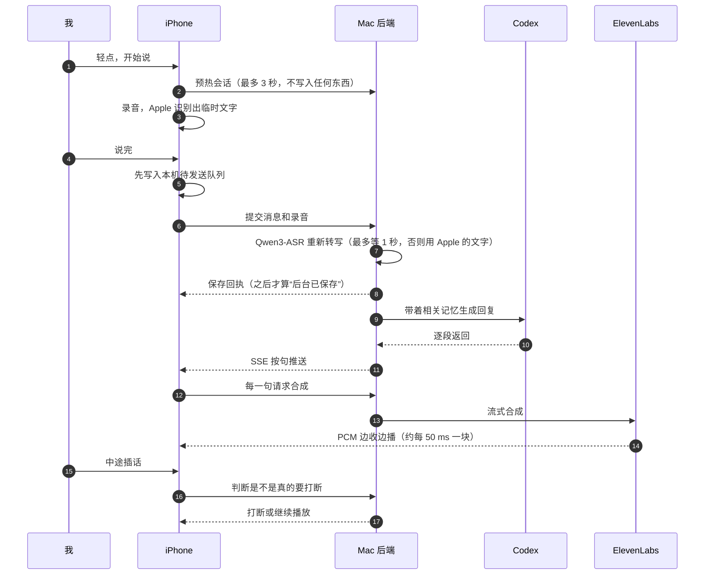
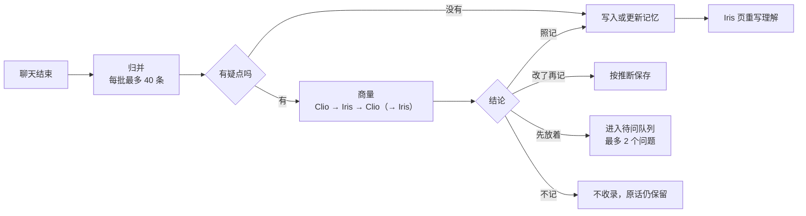
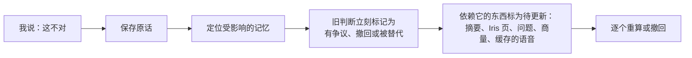

# Iris 架构说明

2026-11-03，对应后端 v0.5（SQLite schema 5）。这里描述的是当前实际运行的结构，以及仍在规划中的部分，源代码不在本仓库。

## 1. 总体

| 部分 | 负责什么 | 不负责什么 |
| --- | --- | --- |
| iPhone | 录音、临时字幕、播放、插话判断；显示记忆、来源、统计；提交纠正；离线时排队 | 不保存第二套权威记忆，不自己做推理 |
| Mac 后端 | 保存原话和录音、转写、聊天调度、记忆整理、版本与纠错、检索、导出、本机 Dashboard | 不把 Codex 或内部端口直接暴露给手机 |
| 模型 | 生成回复、整理候选、商量、写 Iris 页 | 输出必须经过记忆规则校验，不能直接改档案 |
| 语音服务 | 按句合成 PCM | 不存档、不参与记忆 |

现在 iPhone 通过局域网连接 Mac。在外面通过 Cloudflare Tunnel 访问以及云备份都已经定了方向，但暂时搁置。Mac 离线时，手机只记录、不回答，等恢复后再补传。

## 2. 一轮语音对话

几条规则：

- **回执之前不算保存。** 连上了、服务器收到了请求、模型开始回答，都不等于后台已经保存。
- **只有真正播出去的才算说过。** 被打断、没播完的回复只是草稿，不计入“已经告诉过我”。
- **插话要判断意图。** 附近的说话声和短暂的回应不会让播报停下，“等一下”这类明确的话才会。判断不出来就继续播。
- **同一时间只有一个语音会话。** Iris 和 Clio 之间切换时，先结束上一轮，并取消它还没播出的回复。

## 3. 档案和记忆

### 3.1 对象

| 对象 | 内容 | 约束 |
| --- | --- | --- |
| 原始消息 | 原话、录音、转写版本、客户端时间、落盘时间、对话角色 | 保存后不改；转写和摘要另外存 |
| 整理后的记忆 | 标题、正文、类型（事实或推断）、来源、版本 | 每次修改都升版本，旧版本保留 |
| 实体与别名 | 人、项目、游戏、地点、话题；转写出来的不同写法 | 只靠读音相近不会合并，需要确认 |
| 经历 | 一段事情，关联多条来源，带发生时间范围 | 晚到的补述挂回原经历，保留自己的讲述时间 |
| 修订事件 | 谁在什么时候纠正了什么，影响了哪些内容 | 能追踪处理进度和旧判断失效的原因 |
| 问题 | Clio 提出、由 Iris 来问的问题，附带来源和原因 | 依据失效后，问题跟着失效 |
| Clio 的商量与想法 | 真实发言、口语版本、结论、来源 | 只是意见，不能当作用户事实的来源 |

### 3.2 证据和时间

- 证据分为几种：采集到的、我当时说的、我事后回忆的、外部资料、AI 推测。并不是越新的就越对：后来改口可能是目标变了，可能是在纠正，也可能只适用于新的场景。
- 每条经历都有“发生时间”和“获知时间”两个时间。日期不确定就存一个范围，或者标为未知，不会为了排列整齐编一个日期。
- 助手自己的总结不能再拿来当证据。同一段话导入两次，也不会加强某个判断。
- 举例不是经历。我用来描述理想效果的例子会标成“举例，未确认为真实经历”，Iris 能认出来，不会把它当成真事。

### 3.3 保存状态

这几种状态各自独立，界面上不会合并成一个“已保存”。

| 状态 | 什么时候成立 | 意味着什么 |
| --- | --- | --- |
| 已存手机 | 完整输入已写入手机的持久化队列 | 还没到 Mac，卸载 App 可能会丢 |
| 后台已保存 | Mac 已经落盘，并返回可以核对的回执 | 删掉手机上的副本也不影响 |
| 已整理 | 这个版本的转写、归并或记忆任务已完成，并通过版本检查 | 可以用它派生出的记忆 |
| 云端已备份 | 进入一份校验过的版本化备份（规划中） | 显示备份覆盖到哪个时间点 |

手机在第一次本地保存时生成一个稳定的 ID，之后每次重试都用它。同一个 ID 带着同样的内容，Mac 返回原来的回执；同一个 ID 带着不同的内容，Mac 记下冲突，不会悄悄覆盖。

## 4. 后台：Clio

- **调度：** 聊天和后台是两条独立的队列。后台按整理、商量的下一步、每天的想法、Iris 页的顺序领取任务，而且只在聊天空闲时领取。已经在跑的后台调用可以跑完，但下一步不会插到等待中的聊天前面。
- **商量：** 只在 Clio 标了“不对劲”时进行，同一份带版本的依据只商量一次。每句话都存一个口语版本，旁听时念的就是它。
- **想法：** 每天最多一次，而且距离上一次至少新整理了五个不同来源的内容。最多写三条，每条带来源。这些想法只在 Clio 页显示，不进入待问队列，也不推送。
- **归并：** 只接受快照里提供的来源和已有条目的 ID。补充时必须保留旧条目的全部来源。我明确纠正过的正文，后台不能再重写。
- **迟到的结果不提交：** 每个任务都记下它依据的版本，提交前再核对一次。期间如果有纠正或来源变化，旧结果会作废，重新排队。

## 5. 纠错

纠正分四种情况：事实错了就改内容；解释错了就撤回推断；情况变了就加一段新的有效时间；不想被提醒就调整交流方式。

重算还没完成的时候，回答之前的状态检查也会拦住旧判断，不让它当作确定的事实说出来。已经播出去的错误收不回来，会明确更正，并把这次更正也记下来。旁听正在播放的商量，如果依据被纠正了，会立刻停下。

## 6. 检索

- 先判断问题的意图：问起源、问进展、要原话、问某段时期、问偏好变化，还是问跨事件的模式。
- “最开始为什么”会沿着起源路径去找，不会因为旧经历离现在太远就被时间衰减压下去。
- 目前是中文词项索引，加上实体和经历关联。索引随时可以从档案重建，不是档案本身。
- 回答时说清依据：“你在那次聊天里说”“你后来回忆”“我推测”。只有确实存在录音时，才会说“录音里你说”。

## 7. API 一览

所有 `/v1/*` 接口都要求 Bearer 鉴权（token 至少 32 位）。这里只列出接口，完整的字段和错误码没有放进来。

| 分组 | 接口 |
| --- | --- |
| 状态 | `GET /health`、`GET /v1/status`、`GET /v1/health/ready`、`GET /v1/health/integrity` |
| 消息 | `POST /v1/messages`、`GET /v1/messages`、`POST /v1/messages/{id}/retry`、`POST /v1/messages/{id}/cancel`、`POST /v1/messages/{id}/transcription` |
| 流式对话 | `POST /v1/conversations/{id}/prepare`、`GET /v1/messages/{id}/stream`（SSE）、`POST /v1/conversations/{id}/close` |
| 语音 | `POST /v1/speech`、`POST /v1/speech/stream`（PCM s16le、24 kHz、单声道）、`POST /v1/voice/interruption` |
| 附件 | `POST /v1/attachments/{id}`、`GET /v1/attachments/{id}` |
| 记忆 | `GET /v1/memories`、`GET /v1/memories/{id}`、`POST /v1/memories/{id}/corrections` |
| 实体与经历 | `/v1/entities`、`/v1/aliases/{id}/status`、`/v1/episodes`、`/v1/episodes/{id}/links` |
| 检索 | `POST /v1/search`、`POST /v1/index/rebuild` |
| 问题与偏好 | `GET /v1/questions`、`PATCH /v1/questions/{id}`、`POST /v1/questions/{id}/ask`、`GET`/`PATCH /v1/preferences` |
| 页面 | `GET /v1/persona`（Iris 页）、`GET /v1/stats`（我页） |
| Clio | `GET /v1/clio/deliberations`、`GET /v1/clio/deliberations/{id}`、`GET /v1/clio/thoughts`、`GET /v1/agent-exchanges` |
| 同步与任务 | `GET /v1/events`、`GET /v1/jobs/{id}`、`GET /v1/memory-jobs/{id}` |
| 导出 | `POST /v1/export`（SQLite 一致快照、附件和清单） |
| Dashboard | `POST /v1/dashboard/link`、`POST /dashboard/session`、`GET /v1/dashboard` |

和 Clio 对话复用消息接口，只需加上 `agent: "clio"`。一个对话只属于一个角色，混用会返回 409。

## 8. 安全和隐私

- 连接密钥只存在 Mac 的本地配置文件里（权限 0600），不提交、不打印、不写进网页。
- Dashboard 只接受本机请求。用 Bearer 换一个 60 秒内有效、只能用一次的链接，再用它换一个 8 小时的 HttpOnly、SameSite=Strict 会话。跨站请求、跨端口请求、重放都会被拒绝，服务重启后所有会话失效。
- 个人档案、录音和验证资料都放在不进 Git 的运行目录里。
- 外部的文字、网页和转写都只当作资料，其中的指令不能改变采集范围、记忆规则或权限。
- 同一份档案只允许一个写入进程。升级前先导出，在副本上验证迁移，再切换。

## 9. 费用边界

- 推理用的是 Codex 订阅额度。额度用完时，不紧急的任务会延后，不会悄悄换成付费 API，也不会自动购买额度。
- 商量只在有疑点时进行，每次多 2 到 3 次模型调用。想法每天最多一次。
- 语音按字数计费。旁听只在我听的时候才合成，之后从缓存播放。

## 10. 部署的演进

| 阶段 | 状态 |
| --- | --- |
| 本机：Mac 后端，iPhone 走局域网 | 正在用 |
| 外出访问：固定域名和 Cloudflare Tunnel，加上应用自己的认证 | 方向已定，暂缓 |
| 云备份：与 Mac 分开存放的版本化备份，候选 R2 | 方向已定，暂缓 |
| 迁到云服务器：保留 ID、来源和修订历史，单主切换 | 有需要时再做 |

迁移时不会因为“上云”就换掉数据库。先做一致备份、验证恢复，再单主切换，避免两边同时写入。
